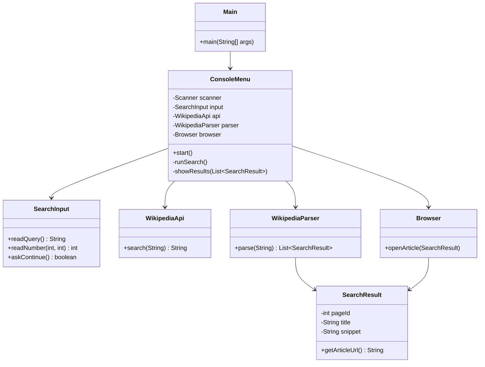

# WikipediaSearch — Практическая работа 2

Консольная Java-программа ищет статьи в русской Википедии через официальный API, показывает результаты и открывает выбранную статью в браузере.

## Структура

```text
WikipediaSearch/
├── src/wikipedia/
│   ├── Main.java             # запуск
│   ├── ConsoleMenu.java     # меню и вывод результатов
│   ├── SearchInput.java    # ввод и проверка запроса/выбора
│   ├── WikipediaApi.java   # HTTP-запрос к API
│   ├── WikipediaParser.java # разбор JSON через Gson
│   ├── SearchResult.java   # модель результата
│   └── Browser.java        # открытие статьи
├── lib/                    # сюда положить Gson JAR
├── .gitignore
└── README.md
```

## Требуется

- JDK 21 (или JDK 17+)
- Visual Studio Code
- расширение Extension Pack for Java
- Gson 2.13.1 (в проекте не используется готовая библиотека для Википедии; Gson нужен для JSON)

## Windows (PowerShell в терминале VS Code)

```powershell
chcp 65001
if (!(Test-Path out)) { New-Item -ItemType Directory out | Out-Null }
javac -encoding UTF-8 -cp "lib/gson-2.13.1.jar" -d out src/wikipedia/*.java
java -Dfile.encoding=UTF-8 -cp "out;lib/gson-2.13.1.jar" wikipedia.Main
```

## macOS / Linux (bash/zsh в терминале VS Code)

```bash
mkdir -p out
javac -encoding UTF-8 -cp "lib/gson-2.13.1.jar" -d out src/wikipedia/*.java
java -Dfile.encoding=UTF-8 -cp "out:lib/gson-2.13.1.jar" wikipedia.Main
```

## Диаграмма классов


